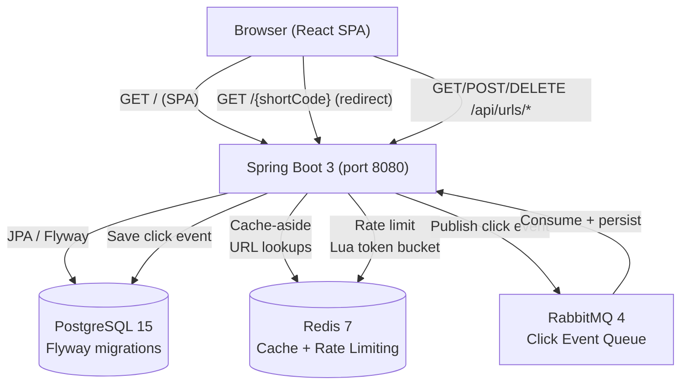

# URL Shortener

A full-stack URL shortener with API-key authentication, Redis caching, asynchronous click tracking via RabbitMQ, and a React single-page application served from the same Spring Boot backend.

**Live demo:** [https://url-shortner-kxv7.onrender.com](https://url-shortner-kxv7.onrender.com)

**Source code:** [https://github.com/Deeviyamssh/URL-Shortner](https://github.com/Deeviyamssh/URL-Shortner)

## Architecture



**Request flow:**

- **Shorten:** Browser → `POST /api/urls` → Spring Boot validates API key → generates Base62 short code from a PostgreSQL sequence → stores mapping in PostgreSQL → returns short code.
- **Redirect:** Browser → `GET /{shortCode}` → Spring Boot checks Redis cache → on miss, queries PostgreSQL and populates cache (TTL 1 hour) → returns 302 redirect → publishes a click event to RabbitMQ (fire-and-forget).
- **Analytics:** RabbitMQ consumer picks up the click event → looks up the URL mapping → persists the click event to PostgreSQL with a UUID for idempotent deduplication.
- **Management:** All `/api/urls/*` endpoints require API-key headers and enforce ownership — users can only see, modify, or query analytics for their own URLs.

## Features

- **URL shortening** with auto-generated Base62 codes (backed by a PostgreSQL sequence for collision-free uniqueness)
- **Custom aliases** with validation (alphanumeric, hyphens, underscores only)
- **Public redirects** — no authentication required to follow a short link
- **API-key authentication** — `X-Access-Key` and `X-Secret-Key` headers; secret is BCrypt-hashed in the database
- **Owner-scoped access** — users can only list, update, delete, and view analytics for their own URLs
- **Click analytics** — per-URL and global, with IP address, user agent, referrer, and timestamp
- **Redis caching** — cache-aside pattern for redirect lookups with configurable TTL
- **Rate limiting** — IP-based (5 req/min) and API-key-based (100 req/hr) via a Redis Lua token-bucket script
- **Asynchronous click tracking** — RabbitMQ decouples redirect response time from analytics persistence
- **React SPA** — built with Vite, served from the Spring Boot JAR in production; dev proxy for local development

## Technology Stack

| Technology | Role |
|------------|------|
| Java 21 | Backend language |
| Spring Boot 3.2.5 | REST API, security, DI, actuator health endpoint |
| Spring Data JPA | ORM layer with Hibernate schema validation |
| PostgreSQL 15 | Primary database for URL mappings, API keys, and click events |
| Flyway | Schema migrations (V1–V3) |
| Redis 7 | Redirect cache + distributed rate limiting |
| RabbitMQ 4 | Asynchronous click-event queue |
| Spring Security | API-key filter chain, endpoint authorization |
| BCrypt | Secret key hashing |
| React 18 + Vite 5 | Frontend SPA |
| Docker (multi-stage) | Build (Node → Maven → JRE) and local Compose |
| Testcontainers | Integration testing with real PostgreSQL, Redis, and RabbitMQ |

## Prerequisites

| Tool | Version |
|------|---------|
| Java | 21 |
| Maven | 3.9+ |
| Node.js | 20+ |
| Docker + Docker Compose | any recent version |

## Quick Start (Docker)

```bash
docker compose up --build
```

The application will be available at `http://localhost:8080` once all services are healthy. PostgreSQL, Redis, and RabbitMQ must pass their health checks before the app starts.

On a fresh database, the app auto-creates a development API key (access key: `dev-access-key`). The secret key is not printed to logs — see `ApiKeyInitializer.java` in the source. Set `APP_DEV_API_KEY_ENABLED=false` in production to disable this.

## Local Development (without Docker)

### 1. Start backing services

```bash
# PostgreSQL
docker run -d --name pg -e POSTGRES_DB=urlshortener -e POSTGRES_USER=user \
  -e POSTGRES_PASSWORD=password -p 5432:5432 postgres:15-alpine

# Redis
docker run -d --name redis -p 6379:6379 redis:7-alpine

# RabbitMQ
docker run -d --name rabbitmq -p 5672:5672 -p 15672:15672 rabbitmq:4-management-alpine
```

### 2. Set environment variables

```powershell
# PowerShell
$env:SPRING_DATASOURCE_URL="jdbc:postgresql://localhost:5432/urlshortener"
$env:SPRING_DATASOURCE_USERNAME="user"
$env:SPRING_DATASOURCE_PASSWORD="password"
$env:SPRING_DATA_REDIS_HOST="localhost"
$env:SPRING_DATA_REDIS_PORT="6379"
$env:SPRING_RABBITMQ_HOST="localhost"
$env:SPRING_RABBITMQ_PORT="5672"
```

```bash
# Bash / macOS / Linux
export SPRING_DATASOURCE_URL=jdbc:postgresql://localhost:5432/urlshortener
export SPRING_DATASOURCE_USERNAME=user
export SPRING_DATASOURCE_PASSWORD=password
export SPRING_DATA_REDIS_HOST=localhost
export SPRING_DATA_REDIS_PORT=6379
export SPRING_RABBITMQ_HOST=localhost
export SPRING_RABBITMQ_PORT=5672
```

### 3. Run the backend

```bash
mvn spring-boot:run
```

Flyway automatically applies all migrations on startup.

### 4. Run the frontend dev server

```bash
cd frontend
npm install
npm run dev
```

The Vite dev server runs on `http://localhost:5173` and proxies all `/api` requests to `http://localhost:8080`.

## Environment Variables

All values can be set via environment variables. Defaults are for local development only.

| Variable | Default | Required (prod) | Description |
|----------|---------|-----------------|-------------|
| `SPRING_DATASOURCE_URL` | `jdbc:postgresql://localhost:5432/urlshortener` | Yes | PostgreSQL JDBC URL |
| `SPRING_DATASOURCE_USERNAME` | `user` | Yes | Database username |
| `SPRING_DATASOURCE_PASSWORD` | `password` | Yes | Database password |
| `SPRING_DATA_REDIS_HOST` | `localhost` | Yes | Redis hostname |
| `SPRING_DATA_REDIS_PORT` | `6379` | No | Redis port |
| `SPRING_RABBITMQ_HOST` | `localhost` | Yes | RabbitMQ hostname |
| `SPRING_RABBITMQ_PORT` | `5672` | No | RabbitMQ AMQP port |
| `SPRING_RABBITMQ_USERNAME` | `guest` | Yes | RabbitMQ username |
| `SPRING_RABBITMQ_PASSWORD` | `guest` | Yes | RabbitMQ password |
| `PORT` | `8080` | Set by platform | The application config supports this variable; hosting platforms may inject it (see Deployment) |
| `SERVER_PORT` | `8080` | No | Alternative port override (used if `PORT` is not set) |
| `APP_DEV_API_KEY_ENABLED` | `true` | Set `false` in prod | Controls auto-creation of a predictable dev API key |

Copy `.env.example` to `.env` and fill in real values. Never commit `.env`.

## API Reference

All `/api/urls` endpoints require `X-Access-Key` and `X-Secret-Key` headers.

### Create a short URL

```bash
curl -s -X POST http://localhost:8080/api/urls \
  -H "Content-Type: application/json" \
  -H "X-Access-Key: <your-access-key>" \
  -H "X-Secret-Key: <your-secret-key>" \
  -d '{"originalUrl": "https://example.com", "customAlias": "demo"}'
```

Response:

```json
{
  "shortCode": "demo",
  "originalUrl": "https://example.com",
  "createdBy": "dev-user"
}
```

The short URL is `{origin}/{shortCode}` (e.g., `http://localhost:8080/demo`). The frontend constructs this from the browser origin.

### Public redirect (no auth required)

```bash
curl -v http://localhost:8080/demo
# HTTP/1.1 302  Location: https://example.com
```

### List your URLs

```bash
curl -s http://localhost:8080/api/urls \
  -H "X-Access-Key: <your-access-key>" \
  -H "X-Secret-Key: <your-secret-key>"
```

Each item includes a `clickCount` field.

### Delete a URL

```bash
curl -s -X DELETE http://localhost:8080/api/urls/1 \
  -H "X-Access-Key: <your-access-key>" \
  -H "X-Secret-Key: <your-secret-key>"
# HTTP 204 No Content
```

### Per-URL click analytics

```bash
curl -s http://localhost:8080/api/urls/1/clicks \
  -H "X-Access-Key: <your-access-key>" \
  -H "X-Secret-Key: <your-secret-key>"
```

### Global click analytics (scoped to your URLs)

```bash
curl -s "http://localhost:8080/api/urls/clicks?limit=50" \
  -H "X-Access-Key: <your-access-key>" \
  -H "X-Secret-Key: <your-secret-key>"
```

Optional query params: `startTime`, `endTime` (ISO-8601), `ipAddress`, `limit` (default 100).

### Health check

```bash
curl -s http://localhost:8080/actuator/health
# {"status":"UP"}
```

## Database and Migrations

Schema management is handled by Flyway. Three migrations run automatically on startup:

| Migration | Description |
|-----------|-------------|
| `V1__initial_schema.sql` | Creates `api_keys`, `url_mappings`, `click_events` tables; sequence for short codes; indexes |
| `V2__align_schema_with_entities.sql` | Renames `hashed_secret` → `hashed_key`; replaces numeric FK with `created_by` owner FK; adds cascade delete for click events |
| `V3__relax_click_event_nulls.sql` | Drops NOT NULL on `ip_address`, `user_agent`, `referrer`; makes `event_id` optional with a partial unique index |

Hibernate is set to `ddl-auto=validate` — it checks that the entity mappings match the migrated schema on every startup.

## Testing

Integration tests use Testcontainers to spin up real PostgreSQL, Redis, and RabbitMQ containers. Docker must be running.

```bash
mvn test
```

The test suite covers:
- Application context loads with Flyway migrations applied
- URL creation (valid, duplicate alias → 409, invalid URL → 400)
- Public redirect (valid code → 302, unknown code → 404)
- Authentication (missing headers → 401/403, wrong secret → 401)
- Ownership scoping (list returns only own URLs, delete cross-owner fails)
- Click analytics (redirect triggers async click persistence)

> **Verification note:** 12 integration tests were reported as passing in a prior development session. Run `mvn test` to verify the current code.

## Frontend Production Build

The `pom.xml` includes a `<resources>` entry that automatically bundles `frontend/dist/` into the JAR's `static` directory.

```bash
cd frontend && npm ci && npm run build
mvn clean package -DskipTests
```

The Docker multi-stage build does this automatically — Stage 1 builds the frontend with Vite, Stage 2 copies `dist/` into `src/main/resources/static` before `mvn package`.

## Deployment

### Live deployment

The application is live at [https://url-shortner-kxv7.onrender.com](https://url-shortner-kxv7.onrender.com).

> **Manual verification needed:** The exact hosting configuration (which managed services provide PostgreSQL, Redis, and RabbitMQ, and how environment variables were set) is not captured in this repository. Confirm these details against your Render dashboard before relying on this deployment.

### Port configuration

The application's `application.properties` supports the `PORT` environment variable:

```
server.port=${PORT:${SERVER_PORT:8080}}
```

If `PORT` is set by the hosting platform, the application listens on that port. If not set, it falls back to `SERVER_PORT`, then to `8080`.

### Alternative deployment (Railway / other Docker-based PaaS)

The repository includes a `railway.toml` for Railway. The same Dockerfile works on any container platform that supports multi-stage builds.

1. Provision PostgreSQL, Redis, and RabbitMQ (Railway offers PostgreSQL and Redis plugins; RabbitMQ requires an external provider like CloudAMQP).
2. Set the environment variables listed in the table above.
3. Set `APP_DEV_API_KEY_ENABLED=false` to prevent predictable dev credentials.
4. The health check endpoint is `/actuator/health`.

### Security: provisioning production API keys

When `APP_DEV_API_KEY_ENABLED=false`, no API keys are auto-created. You must insert one manually.

**How API key authentication works (verified from source):**
- The `access_key` column stores the access key in plaintext — it is used for database lookup via `findByAccessKey()`.
- The `hashed_key` column stores a BCrypt hash of the secret key.
- On each request, the client sends both via headers. The server hashes the incoming secret and compares it to the stored hash using `BCryptPasswordEncoder.matches()`.

**To create a production API key:**

1. Generate a strong, random access key and secret key. Never reuse the development defaults.
2. Hash the secret key with BCrypt:

```bash
# Using Python (produces a $2b$ hash, compatible with Spring's BCryptPasswordEncoder):
python -c "import bcrypt; print(bcrypt.hashpw(b'<your-secret-key>', bcrypt.gensalt()).decode())"
```

3. Insert into your production PostgreSQL:

```sql
INSERT INTO api_keys (owner, access_key, hashed_key, created_at)
VALUES ('<owner>', '<access-key>', '<bcrypt-hash>', NOW());
```

4. Use the access key and secret key in the frontend or API calls.

> **Security note:** Real credentials must never be committed to source control, included in documentation, or sent to client-side JavaScript bundles. The `.gitignore` excludes `.env` files. The frontend stores credentials only in `sessionStorage` (per-tab, cleared on browser close).

## Known Limitations

- **RabbitMQ on PaaS**: Railway does not offer a native RabbitMQ add-on; an external provider like CloudAMQP is needed. Render similarly requires an external RabbitMQ instance.
- **Dev credentials on first run**: On a fresh database with `APP_DEV_API_KEY_ENABLED=true` (the default), the app creates a predictable dev API key. Disable in production.
- **Rate limiting**: IP-based (5 req/min) and API-key-based (100 req/hr) limits are applied via Redis. Adjust `rate.limit.*` properties for your traffic profile.
- **No HTTPS termination**: The application speaks plain HTTP. The hosting platform's reverse proxy (Render, Railway, nginx) handles TLS.
- **Analytics async delay**: Click events are processed via RabbitMQ asynchronously. There may be a brief delay before a redirect registers in analytics.
- **Single API key model**: No user registration or multi-tenant isolation beyond owner scoping. API keys are provisioned via SQL.

## Acknowledgments

Developed with AI assistance from [Kiro](https://kiro.dev), an AI-powered development environment. Code generation, debugging, and test writing were handled by the AI agent under the author's direction.

## Demo Flow

```bash
BASE=http://localhost:8080
ACCESS=dev-access-key
SECRET=dev-secret-key

# 1. Create a short URL
curl -s -X POST $BASE/api/urls \
  -H "Content-Type: application/json" \
  -H "X-Access-Key: $ACCESS" \
  -H "X-Secret-Key: $SECRET" \
  -d '{"originalUrl": "https://example.com", "customAlias": "demo"}'

# 2. Follow the short link (no auth needed)
curl -Lv $BASE/demo

# 3. Check click analytics
curl -s $BASE/api/urls/1/clicks \
  -H "X-Access-Key: $ACCESS" \
  -H "X-Secret-Key: $SECRET"

# 4. Delete the URL
curl -s -X DELETE $BASE/api/urls/1 \
  -H "X-Access-Key: $ACCESS" \
  -H "X-Secret-Key: $SECRET"
```
