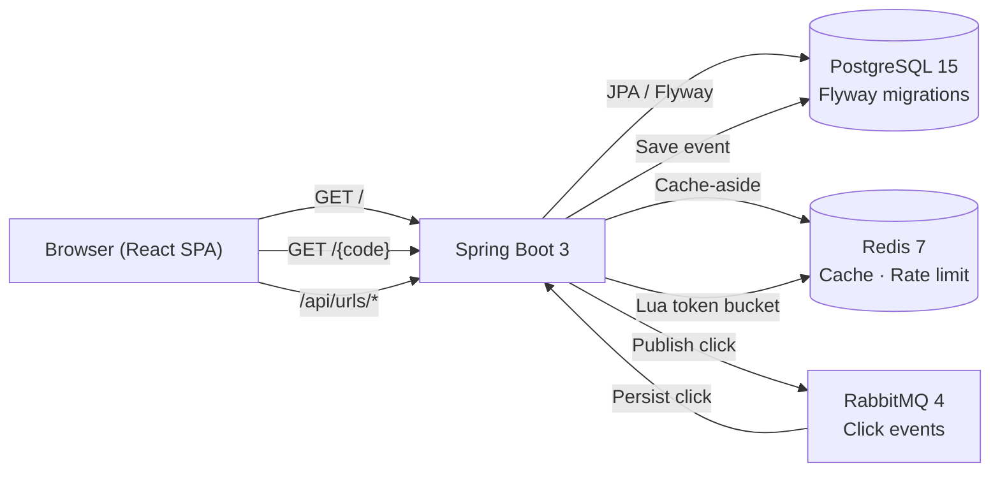

# URL Shortener

A full-stack URL shortener with API-key authentication, Redis caching, asynchronous click-event tracking via RabbitMQ, and a React SPA served from the same Spring Boot JAR.

**[Live Demo](https://url-shortner-kxv7.onrender.com)** · **[GitHub](https://github.com/Deeviyamssh/URL-Shortner)**

---

## Features

- Shorten any URL with an auto-generated Base62 code or a custom alias
- Public redirect — no authentication required to follow a short link
- API-key authentication with BCrypt-hashed secrets
- Per-owner URL management: list, update, and delete
- Click analytics — per-URL and global, with IP, user agent, referrer, and timestamp
- Redis cache-aside pattern for low-latency redirects (1-hour TTL)
- Token-bucket rate limiting via a Redis Lua script (5 req/min by IP, 100 req/hr by key)
- Asynchronous click tracking via RabbitMQ — decouples redirect latency from analytics writes
- React SPA built with Vite, served from the Spring Boot JAR in production
- 13 integration tests using Testcontainers (PostgreSQL, Redis, RabbitMQ)

---

## Architecture



**Redirect flow:** `GET /{code}` → Redis lookup (cache hit: instant) → DB fallback (cache miss: populate cache) → 302 to destination → publish click event to RabbitMQ (fire-and-forget) → consumer persists click with UUID idempotency key.

---

## Tech Stack

| Layer | Technology |
|-------|-----------|
| Backend | Java 21 · Spring Boot 3.2.5 · Spring Security · Spring Data JPA |
| Database | PostgreSQL 15 · Flyway (3 migrations) · Hibernate schema validation |
| Cache / Rate limiting | Redis 7 · Lua scripting |
| Async messaging | RabbitMQ 4 · Spring AMQP |
| Frontend | React 18 · Vite 5 |
| Testing | Testcontainers · JUnit 5 · AssertJ |
| Deployment | Docker (3-stage build) · Render |

---

## Quick Start

**Docker (all services):**

```bash
docker compose up --build
# App available at http://localhost:8080
```

On a fresh database the app auto-creates a dev API key (`dev-access-key`). The secret key is not logged — see `ApiKeyInitializer.java`. Set `APP_DEV_API_KEY_ENABLED=false` in production.

**Local development (separate processes):**

```bash
# 1. Start backing services
docker compose up -d postgres redis rabbitmq

# 2. Set environment variables (PowerShell)
$env:SPRING_DATASOURCE_URL="jdbc:postgresql://localhost:5432/urlshortener"
$env:SPRING_DATASOURCE_USERNAME="user"
$env:SPRING_DATASOURCE_PASSWORD="password"
$env:SPRING_DATA_REDIS_HOST="localhost"
$env:SPRING_RABBITMQ_HOST="localhost"

# 3. Run backend
mvn spring-boot:run

# 4. Run frontend dev server (proxies /api to localhost:8080)
cd frontend && npm install && npm run dev
```

---

## API

All `/api/urls` endpoints require `X-Access-Key` and `X-Secret-Key` headers.

```bash
BASE=http://localhost:8080
ACCESS=dev-access-key
SECRET=dev-secret-key

# Create a short URL
curl -s -X POST $BASE/api/urls \
  -H "Content-Type: application/json" \
  -H "X-Access-Key: $ACCESS" -H "X-Secret-Key: $SECRET" \
  -d '{"originalUrl":"https://example.com","customAlias":"demo"}'
# → {"shortCode":"demo","originalUrl":"https://example.com","createdBy":"dev-user"}

# Follow the short link (public — no auth)
curl -Lv $BASE/demo

# List your URLs (use the returned id in the analytics/delete calls below)
curl -s $BASE/api/urls -H "X-Access-Key: $ACCESS" -H "X-Secret-Key: $SECRET"

# Per-URL analytics  (replace 1 with the actual id from the list above)
curl -s $BASE/api/urls/1/clicks -H "X-Access-Key: $ACCESS" -H "X-Secret-Key: $SECRET"

# Delete a URL  (replace 1 with the actual id)
curl -s -X DELETE $BASE/api/urls/1 -H "X-Access-Key: $ACCESS" -H "X-Secret-Key: $SECRET"

# Health check
curl -s $BASE/actuator/health
```

---

## Testing

Integration tests require Docker (Testcontainers spins up real PostgreSQL, Redis, and RabbitMQ containers):

```bash
mvn test
```

> 13 integration tests were passing as of the last verified run. Re-run to confirm on your machine.

Tests cover: context load + Flyway migrations, URL creation, duplicate alias (409), invalid input (400), public redirect (302/404), authentication failures, ownership scoping, concurrent duplicate handling, click analytics, and global analytics scoping.

---

## Deployment

The application is live at **[https://url-shortner-kxv7.onrender.com](https://url-shortner-kxv7.onrender.com)** on Render using the multi-stage `Dockerfile` in this repository.

The app reads `PORT` (injected by the hosting platform), `SERVER_PORT`, or defaults to `8080`:

```
server.port=${PORT:${SERVER_PORT:8080}}
```

**Required environment variables:**

| Variable | Description |
|----------|-------------|
| `SPRING_DATASOURCE_URL` | PostgreSQL JDBC URL |
| `SPRING_DATASOURCE_USERNAME` | Database username |
| `SPRING_DATASOURCE_PASSWORD` | Database password |
| `SPRING_DATA_REDIS_HOST` | Redis hostname |
| `SPRING_DATA_REDIS_PORT` | Redis port (default `6379`) |
| `SPRING_RABBITMQ_HOST` | RabbitMQ hostname |
| `SPRING_RABBITMQ_PORT` | RabbitMQ AMQP port (default `5672`) |
| `SPRING_RABBITMQ_USERNAME` | RabbitMQ username |
| `SPRING_RABBITMQ_PASSWORD` | RabbitMQ password |
| `APP_DEV_API_KEY_ENABLED` | Set `false` in production |

A `railway.toml` was previously included for Railway deployment. The app deploys on Render using the `Dockerfile` directly.

**Provisioning a production API key** (when `APP_DEV_API_KEY_ENABLED=false`):

```bash
# Generate a BCrypt hash for your secret key
python -c "import bcrypt; print(bcrypt.hashpw(b'<your-secret>', bcrypt.gensalt()).decode())"
```

```sql
INSERT INTO api_keys (owner, access_key, hashed_key, created_at)
VALUES ('<owner>', '<access-key>', '<bcrypt-hash>', NOW());
```

---

## Known Limitations

- No user registration — API keys are provisioned via SQL
- RabbitMQ requires an external provider on PaaS platforms (e.g. CloudAMQP on Railway; on Render, configure an external RabbitMQ instance)
- Analytics writes are asynchronous — brief delay after a redirect before the click appears
- IP-based rate limit is 5 req/min; adjust `rate.limit.ip.*` properties for your traffic profile

---

## Acknowledgments

Developed with AI assistance from [Kiro](https://kiro.dev). Code generation, debugging, and test writing were handled by the AI agent under the author's direction.
